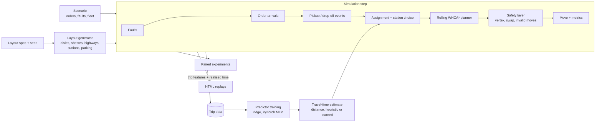

# Warehouse robot coordination simulator

A deterministic grid-warehouse simulator with a collision-free multi-robot planner, and a controlled
study of whether a **learned travel-time / congestion predictor** improves fleet operations over a
strong classical baseline **on unseen warehouse layouts**.

> **Status:** complete (all six milestones). Simulation study only: simplified physics, perfect
> localisation, no sensing. Not a reproduction of any production system and not a real-robot
> safety claim.

## Architecture



Rules, recovery behaviour and design decisions: [docs/01-architecture.md](docs/01-architecture.md).
Brief: [SPEC.md](SPEC.md) · Plan and progress: [PLAN.md](PLAN.md)

## Answer to the research question (2026-10-06)

**On unseen layouts, the learned predictor is 21–36% more accurate than shortest-path distance, but
it does not measurably beat a tuned two-parameter congestion heuristic in closed-loop operation.**
Almost all of the gain over naive planning comes from being queue/congestion-aware at all, which
the heuristic already captures.

### Closed loop: 80 paired scenarios on held-out layout families

Two unseen families (`wide-10x5`, `long-7x8-2st`) × 10 seeds × 20/40 robots × 2 load regimes, with
blocked aisles and a robot failure in every run. 1,000 steps each. Every policy runs the identical
scenario; the router, safety layer and orders are shared. Only the travel-time estimate behind
job assignment and station choice differs. `results/summary/compare_heldout.json`

| Policy | Jobs (moderate) | Jobs (saturated) | p95 cycle (moderate) | Urgent missed (saturated) |
| --- | --- | --- | --- | --- |
| distance (naive) | 298.8 | 361.6 | 74.4 | 25.1 |
| heuristic (tuned: +2/robot on path, +6/robot heading to goal) | 372.3 | 607.3 | 80.5 | 2.6 |
| learned ridge | 375.0 | 603.3 | 66.4 | 2.4 |
| **learned MLP** | **378.7** | **611.0** | **66.2** | **1.8** |

Paired differences (95% t-interval; better/worse scenario counts out of 40):

| Comparison | Jobs, moderate | Jobs, saturated | p95 cycle, moderate |
| --- | --- | --- | --- |
| heuristic vs distance | **+73.5** [29.8, 117.3] | **+245.7** [164.6, 326.8] | |
| MLP vs **heuristic** | +6.4 [−0.4, 13.3], 19/9 | +3.7 [−12.9, 20.3], 24/16 | −14.3 [−30.8, 2.3], 28/7 |

On training-family layouts (40 scenarios) MLP and heuristic are also indistinguishable on jobs.
The MLP has significantly *more* stuck episodes at saturation there (+6.5 per run [0.9, 12.0]).

**Reading this honestly.** The MLP's moderate-load tail latency is suggestive (lower p95 in 28 of
40 scenarios) but its interval includes zero. Two reasons the advantage may be small:
(1) the training data comes from the distance policy, so the model never saw the trip
distribution its own decisions create (no data-aggregation round yet); (2) cost estimates only
steer assignment and station choice, while the router still uses static distances.

### Follow-up: retraining on the model's own trips (data aggregation, round 1)

Suspected cause of the null result: the model trained only on trips from the distance policy, so it
never saw the trips its own assignments create. Round 1 collected 156k trips with the learned
policy on the training layouts, retrained on both rounds, and re-ran the same 80 held-out
scenarios. The earlier policies reproduced exactly, so the comparison is paired and clean.
`results/summary/aggregate_r1.json`, `results/raw/compare_heldout-aggregated.jsonl`

| On held-out trips made by the learned policy | MAE | MAE, congested | Rank corr. |
| --- | --- | --- | --- |
| distance | 4.29 | 16.0 | 0.27 |
| original MLP (round 0) | 3.63 | 10.1 | 0.54 |
| retrained MLP (round 1) | 3.61 | 10.0 | 0.56 |

| Round-1 model, paired differences (95% CI) | Jobs, moderate | Jobs, saturated | Urgent missed, saturated |
| --- | --- | --- | --- |
| vs tuned heuristic | −2.0 [−14.8, 10.9] | −15.4 [−34.8, 4.0] | +1.3 [−1.4, 4.0] |
| vs original model | −8.4 [−18.8, 2.0] | **−19.1 [−34.1, −4.1]** | **+2.1 [0.4, 3.8]** |

**Conclusion:** distribution shift was not the bottleneck. The original model was already as accurate
on its own trips, and retraining made saturated operation slightly *worse*. The limit is the
decision value of a better estimate beyond what the queue-aware rule captures. More promising
next steps: learn the assignment objective directly (e.g. estimated completion rate rather than
trip time), or use learned congestion costs inside routing.

### Predictor accuracy (`results/summary/predictor.json`)

Realised travel time of ~59k trips on held-out layouts:

| Model | MAE (steps) | MAE on congested trips (≥1.5× distance) | Rank corr. of predicted vs actual delay |
| --- | --- | --- | --- |
| shortest-path distance | 5.71 | 23.8 | 0.19 |
| distance, calibrated (a·d + b) | 6.47 | 20.3 | 0.07 |
| ridge on 11 features | 5.77 | 16.0 | 0.52 |
| MLP 2×64, 3 seeds | **4.46–4.52** | **15.1–15.5** | **0.55–0.57** |

Trained on ~107k trips from training families only (seeds 1–6), early-stopped on seeds 7–8.
Held-out families never reach training data (enforced by a test).

### The strong baseline mattered more than the model

- **Naive station choice loses most of the throughput.** Sending each loaded robot to its nearest
  station creates queues. The heuristic's queue term alone takes training-layout throughput from
  373 to 565 jobs. The tuning grid is flat beyond that (553–576), so it isn't fragile.
- **The first router was sloppy.** It cleared all reservations each round, needed ~430 safety-layer
  interventions per run, and finished 606 jobs. Rolling replanning (each robot replans around
  everyone's still-valid plans) gave **0 interventions and 749 jobs (+24%)**. All data, models and
  comparisons were redone on the improved router (`results/superseded_clear_router/`).

### Scaling (XL layout, saturated, tuned heuristic)

| Robots | Jobs / 1000 steps | Jobs per robot | Stuck at end | Planner p95 per step |
| --- | --- | --- | --- | --- |
| 20 | 358 | 17.9 | 0 | 1.3 ms |
| 50 | 810 | 16.2 | 0 | 5.5 ms |
| 100 | 1,159 | 11.6 | 29 | 10.0 ms |

Near-linear to 50 robots. At 100, prioritised planning starts to gridlock: compute is fine,
coordination isn't. This is where a stronger MAPF method (e.g. PIBT or rule-based traffic
lanes) would be the next step.

**Collisions: 0 in every run.** The safety layer asserts it each step; vertex and edge-swap rules are unit-tested.

## Side-by-side replays

`results/replay/distance-vs-heuristic.html` (277 vs 862 jobs: watch the station queues) and
`results/replay/heuristic-vs-learned.html` (862 vs 852). These are self-contained files; open them in a browser.

## Run it

```bash
uv venv --system-site-packages --python /usr/bin/python3 && uv sync   # numpy/scipy/torch from the host
uv run pytest                                      # 15 tests: collision rules, recovery, determinism, stats, leakage
uv run python -m runner.experiment router-ablation # clear vs rolling WHCA*
uv run python -m predictor.dataset                 # trips from training layouts (~40 s, 10 workers)
uv run python -m predictor.train                   # distance / ridge / MLP accuracy
uv run python -m runner.experiment tune-heuristic  # heuristic weights on training layouts
uv run python -m runner.experiment compare         # 80 held-out scenarios x 4 policies (~1 min)
uv run python -m predictor.aggregate --round 1      # retrain on the learned policy's own trips
uv run python -m runner.experiment compare-aggregated
uv run python -m runner.experiment scaling
uv run python -m viz.export --left heuristic --right learned-mlp --out results/replay/demo.html
```

### macOS (Apple silicon)

Supported for local development. Linux behaviour is unchanged, and published numbers come from the
GX10, so Mac timings aren't comparable. The macOS code paths are tested on Linux but have **not yet
been run on a real Mac**. Minimum setup:

```bash
uv sync --extra standalone && uv run pytest
uv run python -m runner.experiment compare --workers 8
```

Memory and per-step details for a 16 GB Mac are in the portfolio's `RUN_ON_MAC_M4_16GB.md` guide.

## Limitations

- Robots execute plans exactly: no stochastic delays, no localisation error, no physical dynamics.
- Traffic, layouts and faults are synthetic. Two held-out families test geometric generalisation,
  not real warehouses.
- One round of on-policy data aggregation was tried (no gain; see above). More rounds were not.
- One fault mix per scenario (2 blocked segments, 1 robot failure). Severity was not swept.
- The optional systems extension (serving the predictor remotely with injected latency and a safe
  fallback) is not done.

## Docs

Start with [start.md](start.md) to run it. The design record is in [docs/](docs/README.md):

| # | Doc | What it settles |
| --- | --- | --- |
| 00 | [Charter](docs/00-charter.md) | Question, scope, success criteria |
| 01 | [Architecture](docs/01-architecture.md) | Step loop, design rules, components |
| 02 | [Coordination](docs/02-coordination.md) | Rolling WHCA*, safety layer, faults, scaling |
| 03 | [Cost estimators](docs/03-estimators.md) | Heuristic vs learned, features, splits, accuracy |
| 04 | [Evaluation](docs/04-evaluation.md) | Paired design, statistics, all closed-loop results |
| 05 | [Risks](docs/05-risks.md) | Thesis risks, claim hygiene |
| 06 | [Roadmap](docs/06-roadmap.md) | Milestone status, next experiments |
| 07 | [Learning checklist](docs/07-learning-checklist.md) | Skills per milestone, interview points |
| 08 | [Implementation notes](docs/08-implementation-notes.md) | Where the code departs from the plan |

Part of a six-project engineering portfolio.
